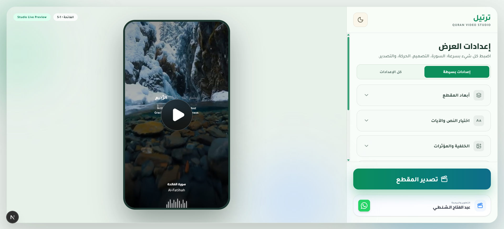

# Trteel Quran Video Studio

[](https://github.com/AbdAlftahSalem/trteel/actions/workflows/ci.yml)
[](LICENSE)

Trteel is a full web studio for creating beautiful Quran recitation videos with synchronized ayahs, translations, animated effects, and one-click export.



---

## English Documentation

### 1. Project Overview

Trteel helps creators produce social-ready Quran clips directly from the browser.

Main goals:

- Fast workflow from ayah selection to final export
- High visual quality with animated text and background controls
- Support for multiple reciters and translation languages
- Export presets for Story, Post, TikTok, YouTube, and WhatsApp

---

### 2. Core Features

#### Quran and Audio

- Pick a Surah and ayah range
- Choose reciter from available list
- Automatic ayah-by-ayah playback logic

#### Translation

- Optional translation layer
- Supported languages:
	- English
	- Spanish
	- French
- Adjustable translation size and color

#### Visual Customization

- Aspect ratios:
	- 9:16
	- 1:1
	- 16:9
	- 4:5
- Background options:
	- Built-in backgrounds
	- Uploaded image
	- Uploaded video with trim range
	- Background dim and blur controls
- Text styling:
	- Ayah font size and color
	- Position controls (X/Y)
	- Optional Surah name with position and size
	- Optional glass effect for ayah container

#### Audio and Motion Effects

- Waveform display with position/height/color
- Word sync modes:
	- Karaoke highlight
	- Fade reveal
- Audio FX:
	- Natural
	- Studio reverb
	- Mosque echo

#### Watermark and Safety

- Watermark as image or text
- Watermark size, opacity, and position controls
- Safe area overlay for social platforms

#### Export Engine

- Presets:
	- Instagram Story
	- Instagram Post
	- TikTok
	- YouTube
	- WhatsApp Status
- Quality levels:
	- Low (3 Mbps)
	- Medium (5 Mbps)
	- High (8 Mbps)
- Progress indicator during export

#### Simple UX Mode

- Simple and Advanced settings modes
- Clean default path for quick creation

#### New Background Video Mute Option

- When video background is selected, you can mute/unmute background video audio
- Default is ON (muted)

---

### 3. Tech Stack

- Next.js 16 (App Router)
- React 19
- TypeScript
- Tailwind CSS v4
- Lucide React icons
- WebCodecs + mp4-muxer (in-browser MP4 encoding)
- ffmpeg-static (server-side re-encode for social presets)

---

### 4. Project Structure

Key folders:

- src/app
	- Main UI pages and root layout
	- API routes (`api/instagram-fix`, `api/export`) that run FFmpeg
- src/components
	- UI controls, settings panels, and preview modules
- src/hooks
	- State management and playback/export hooks
- src/utils
	- Export pipeline and rendering helpers
- src/assets
	- Background images and Quran datasets

---

### 5. Installation and Run

Requirements:

- Node.js 20.9 or newer (required by Next.js 16)
- npm (or pnpm/yarn)

Install:

```bash
npm install
```

Run development server:

```bash
npm run dev
```

Build production version:

```bash
npm run build
```

Start production server:

```bash
npm run start
```

Lint:

```bash
npm run lint
```

---

### 6. How Export Works

1. The browser draws every frame on a canvas from the selected ayahs and settings.
2. Audio is prepared and mixed with the optional effects.
3. Frames and audio are encoded to H.264/AAC in the browser (WebCodecs) and packed into an MP4 with mp4-muxer.
4. For the Instagram, TikTok and WhatsApp presets, the MP4 is sent to `POST /api/instagram-fix`, which re-encodes it with FFmpeg (H.264 Main 4.0, yuv420p, faststart) so those apps accept it. If that step fails or times out, the browser keeps its own MP4.
5. The browser downloads the video.

API endpoints:

- `POST /api/instagram-fix`: re-encode an MP4 for social apps (form fields `video`, `filename`)
- `POST /api/export`: build an MP4 from JPEG frames (or a video) plus audio (form fields `frames` / `video`, `audio`, `settings` with `fps` 1–60 and `bitrate` like `6000k`)

---

### 7. Typical User Flow

1. Choose reciter and surah
2. Select ayah range
3. Pick aspect ratio/preset
4. Configure background and text style
5. Optional translation/watermark/effects
6. Export video

---

### 8. Notes and Best Practices

- Prefer Simple settings mode for fast content creation.
- Use medium or high quality for publication.
- Keep key text inside safe area for social apps.
- If using video background, keep trim range short for better performance.

---

### 9. License

This project is licensed under the [MIT License](LICENSE).

---

## Arabic description

### 1. نظرة عامة على المشروع

ترتيل هو استوديو ويب كامل لإنشاء فيديوهات قرآنية جميلة مع مزامنة الآيات، والترجمة، والمؤثرات، والتصدير مباشرة من المتصفح.

الأهداف الأساسية:

- سير عمل سريع من اختيار الآيات حتى التصدير النهائي
- جودة بصرية عالية مع تحكم كامل في التصميم
- دعم القرّاء ولغات الترجمة المختلفة
- قوالب جاهزة للنشر على المنصات الاجتماعية

---

### 2. المزايا الأساسية

#### القرآن والصوت

- اختيار السورة ونطاق الآيات
- اختيار القارئ
- تشغيل متزامن آية بآية

#### الترجمة

- إظهار/إخفاء الترجمة
- اللغات المدعومة:
	- الإنجليزية
	- الإسبانية
	- الفرنسية
- التحكم بحجم ولون الترجمة

#### التخصيص البصري

- أبعاد الفيديو:
	- 9:16
	- 1:1
	- 16:9
	- 4:5
- الخلفيات:
	- خلفيات جاهزة
	- صورة مرفوعة
	- فيديو مرفوع مع القص (Trim)
	- تحكم في التعتيم والضبابية
- تنسيق النص:
	- حجم ولون الآية
	- تغيير الموقع (X/Y)
	- إظهار اسم السورة مع التحكم بالحجم والموقع
	- تأثير زجاجي لصندوق الآية

#### المؤثرات الصوتية والحركية

- موجة صوت مع تحكم كامل
- مزامنة الكلمات:
	- كاريوكي (Highlight)
	- ظهور تدريجي (Fade)
- المؤثرات الصوتية:
	- طبيعي
	- صدى استوديو
	- صدى مسجد

#### العلامة المائية ومنطقة الأمان

- علامة مائية كصورة أو نص
- التحكم بالحجم والشفافية والموقع
- إظهار منطقة الأمان لمنصات التواصل

#### محرك التصدير

- قوالب النشر:
	- Instagram Story
	- Instagram Post
	- TikTok
	- YouTube
	- WhatsApp Status
- مستويات الجودة:
	- منخفضة (3 Mbps)
	- متوسطة (5 Mbps)
	- عالية (8 Mbps)
- شريط تقدم أثناء التصدير

#### وضع الإعدادات البسيط

- وضع بسيط ووضع متقدم
- تجربة أسرع للمستخدم في الوضع البسيط

#### خيار كتم فيديو الخلفية الجديد

- عند اختيار خلفية فيديو، يظهر خيار كتم/إلغاء كتم صوت الفيديو
- الحالة الافتراضية: مفعّل (الكتم ON)

---

### 3. التقنيات المستخدمة

- Next.js 16 (App Router)
- React 19
- TypeScript
- Tailwind CSS v4
- Lucide React
- WebCodecs + mp4-muxer لترميز الفيديو داخل المتصفح
- ffmpeg-static لإعادة الترميز على الخادم لقوالب السوشال ميديا

---

### 4. هيكلية المشروع

المجلدات المهمة:

- src/app
	- الصفحات الأساسية والتخطيط العام
	- مسارات API (`api/instagram-fix` و `api/export`) التي تشغّل FFmpeg
- src/components
	- واجهات التحكم والإعدادات والمعاينة
- src/hooks
	- إدارة الحالة والتشغيل والتصدير
- src/utils
	- أدوات الرسم والتصدير
- src/assets
	- الصور وملفات بيانات القرآن

---

### 5. التثبيت والتشغيل

المتطلبات:

- Node.js 20.9 أو أعلى (مطلوب لـ Next.js 16)
- npm أو pnpm أو yarn

التثبيت:

```bash
npm install
```

تشغيل بيئة التطوير:

```bash
npm run dev
```

بناء نسخة الإنتاج:

```bash
npm run build
```

تشغيل نسخة الإنتاج:

```bash
npm run start
```

فحص الكود:

```bash
npm run lint
```

---

### 6. آلية التصدير

1. المتصفح يرسم كل إطار على canvas حسب الآيات والإعدادات.
2. يتم تجهيز الصوت ودمجه مع المؤثرات (إن وُجدت).
3. يتم ترميز الإطارات والصوت داخل المتصفح (WebCodecs) وتجميعها في ملف MP4 عبر mp4-muxer.
4. في قوالب إنستغرام وتيك توك وواتساب، يُرسل الملف إلى `POST /api/instagram-fix` ليعيد FFmpeg ترميزه بصيغة تقبلها هذه التطبيقات. إذا فشلت هذه الخطوة يُستخدم ملف المتصفح كما هو.
5. يتم تنزيل الفيديو إلى جهاز المستخدم.

مسارات API:

- `POST /api/instagram-fix`
- `POST /api/export`

---

### 7. سير العمل المقترح

1. اختر القارئ والسورة
2. حدّد نطاق الآيات
3. اختر المقاس أو قالب المنصة
4. نسّق الخلفية والنص
5. فعّل الترجمة أو العلامة المائية أو المؤثرات حسب الحاجة
6. صدّر الفيديو

---

### 8. نصائح مهمة

- استخدم الوضع البسيط للإنجاز السريع.
- للتصدير النهائي، يفضل الجودة المتوسطة أو العالية.
- حافظ على النصوص داخل منطقة الأمان.
- عند استخدام فيديو خلفية، اجعل مدة القص قصيرة لتحسين الأداء.

---

### 9. الترخيص

المشروع مرخّص تحت [رخصة MIT](LICENSE).
